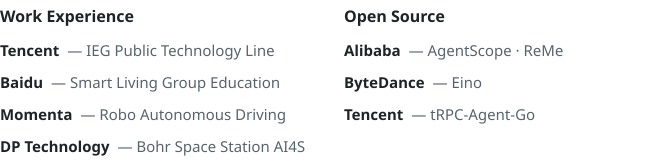

  
  

    
    <strong>I'm currently focused on intelligence, artificial & human.</strong>
  

  <i>Models improve by loops — and so do the engineers who build them. I live in the loop I engineer. Alignment runs both ways: I align models to humans, and myself to models. Two learners, one recursive path, renewing each other — day after day.</i>

 

